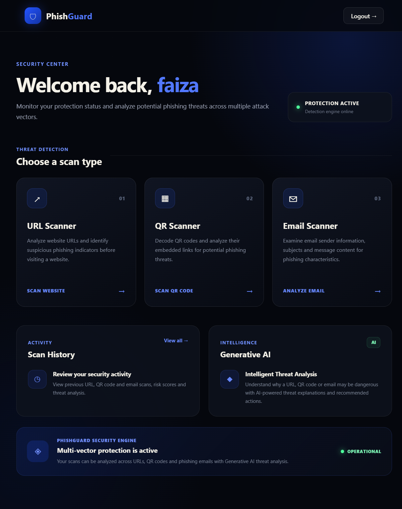
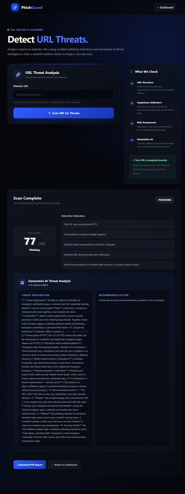
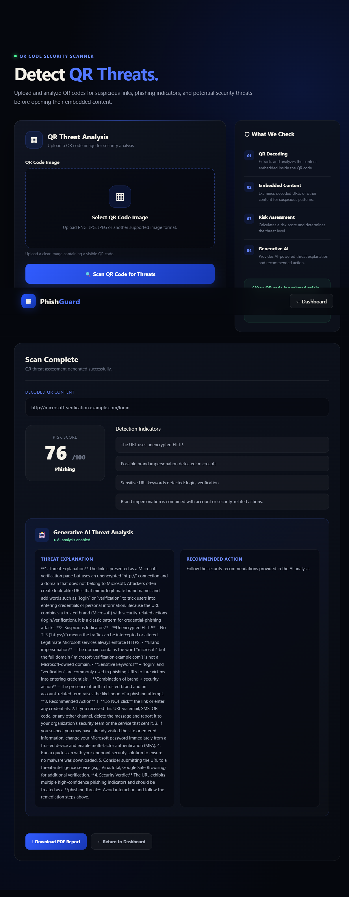
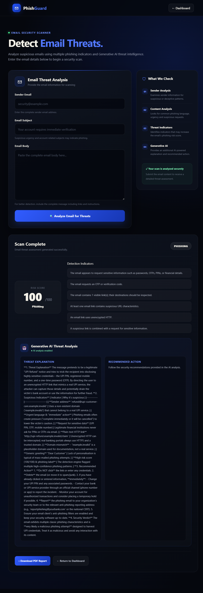
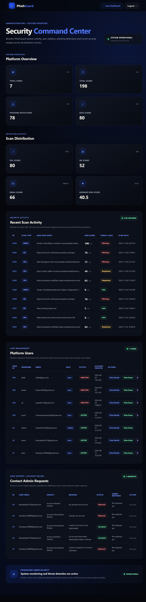

# PhishGuard

### AI-Powered Multi-Vector Phishing Detection Suite Using Generative AI

PhishGuard is a Flask-based cybersecurity web application designed to identify potential phishing threats through multiple detection channels: URLs, QR codes, and emails.

The system combines rule-based phishing detection techniques with Generative AI-powered threat analysis to help users understand suspicious indicators, assess risk, and receive security recommendations.

---

## 1. Project Overview

Phishing attacks use deceptive websites, malicious links, QR codes, and fraudulent emails to trick users into revealing sensitive information or performing unsafe actions.

PhishGuard provides a centralized platform where users can submit URLs, upload QR code images, and analyze email content. The application evaluates potential phishing indicators, generates risk assessments, and provides AI-assisted explanations.

The application also includes user authentication, password recovery, scan history, downloadable PDF reports, Contact Admin functionality, request-status tracking, and administrative management features.

---

## 2. Key Features

### 2.1 User Authentication

- User registration and login.
- Session-based authentication.
- Protected application pages.
- Password hashing.
- User account management.

### 2.2 Forgot Password and Password Reset

- Dedicated Forgot Password page.
- Password recovery using secure reset links.
- Time-limited password-reset tokens.
- Reset tokens expire after 30 minutes.
- New passwords are securely hashed before database updates.
- Email configuration through Flask-Mail.

### 2.3 URL Phishing Detection

- Analyzes submitted URLs.
- Checks for suspicious URL characteristics.
- Evaluates potential phishing indicators.
- Produces a risk score and risk classification.

### 2.4 QR Code Phishing Detection

- Supports QR code image uploads.
- Decodes QR code content.
- Analyzes decoded URLs for potential phishing indicators.
- Provides risk assessments.

### 2.5 Email Phishing Detection

- Analyzes email sender information.
- Examines email subjects and message content.
- Identifies suspicious email characteristics.
- Provides risk assessments.

### 2.6 Generative AI Threat Analysis

- Uses the Groq API for AI-powered threat analysis.
- Explains detected security indicators.
- Provides recommended security actions.
- Generates a final security verdict.
- Includes fallback analysis when the AI service is unavailable.

### 2.7 Scan History

- Stores users' scan records.
- Maintains scan information and risk assessments.
- Allows users to review previous scans.

### 2.8 PDF Report Generation

- Generates downloadable PDF reports.
- Includes scan information and risk assessments.
- Provides AI analysis and security recommendations where available.

### 2.9 Admin Dashboard

- Provides an administrative overview.
- Displays user and scan information.
- Supports user detail and scan-history views.
- Allows administrators to manage user roles and account status.
- Supports Contact Admin request management.

### 2.10 Contact Admin

- Allows users to submit support or account-related requests.
- Stores submitted requests in the database.
- Allows administrators to review requests.
- Supports administrative responses.
- Provides request-status tracking.

### 2.11 Request Status Tracking

Users can check the status of their submitted Contact Admin requests.

The request system supports three statuses:

| Status | Description |
|---|---|
| Pending | The request is waiting for administrator review. |
| Accepted | The administrator has accepted the request. |
| Rejected | The administrator has rejected the request. |

Administrators can provide a response explaining their decision.

Accepting a request does not automatically reactivate a deactivated account. Account activation remains a separate administrative operation.

---

## 3. Technology Stack

| Category | Technology |
|---|---|
| Programming Language | Python |
| Backend Framework | Flask |
| Frontend | HTML, CSS |
| Database | MySQL |
| Database Connector | MySQL Connector/Python |
| Authentication | Flask-Login |
| Form Security | Flask-WTF |
| Email Support | Flask-Mail |
| AI Integration | Groq API |
| QR Code Processing | OpenCV, pyzbar |
| Image Processing | Pillow |
| PDF Generation | ReportLab |
| Environment Configuration | python-dotenv |
| Password Reset Tokens | itsdangerous |

---

## 4. Project Folder Structure

```text
AI_Powered_Phishing_Detection_Suite/
│
├── database/
│   └── db.py
│
├── models/
│
├── modules/
│   ├── ai_analyzer.py
│   ├── email_detector.py
│   ├── qr_detector.py
│   └── url_detector.py
│
├── reports/
│   └── pdf_report.py
│
├── routes/
│   ├── admin.py
│   ├── auth.py
│   ├── dashboard.py
│   ├── email.py
│   ├── history.py
│   ├── qr.py
│   ├── url.py
│   └── __init__.py
│
├── services/
│
├── static/
│   └── css/
│       └── style.css
│
├── templates/
│   ├── admin_dashboard.html
│   ├── admin_user_scans.html
│   ├── base.html
│   ├── contact_admin.html
│   ├── dashboard.html
│   ├── email_scan.html
│   ├── forgot_password.html
│   ├── home.html
│   ├── login.html
│   ├── qr_scan.html
│   ├── register.html
│   ├── request_status.html
│   ├── reset_password.html
│   ├── scan_history.html
│   ├── url_scan.html
│   └── view_user.html
│
├── uploads/
│
├── docs/
│   └── screenshots/
│       ├── dashboard.png
│       ├── url_detection_result.png
│       ├── qr_detection_result.png
│       ├── email_detection_result.png
│       └── admin_dashboard.png
│
├── .env.example
├── .gitignore
├── app.py
├── config.py
├── requirements.txt
└── README.md
```

The `models`, `services`, and `reports` folders may contain additional files. The virtual environment and Python cache files should not be committed to GitHub.

---

## 5. Database Design

PhishGuard uses MySQL as its relational database.

**Database Name:**

```sql
phishing_detection
```

The application uses the following main tables:

### 5.1 Users Table

Stores registered user information and account details.

| Column | Description |
|---|---|
| id | Unique user ID |
| username | User's username |
| email | Registered email address |
| password_hash | Hashed password |
| role | User or administrator role |
| created_at | Account creation timestamp |
| is_active | Account activation status |

### 5.2 Scans Table

Stores phishing detection records.

| Column | Description |
|---|---|
| id | Unique scan ID |
| user_id | Associated user ID |
| scan_type | URL, QR, or Email |
| input_data | Submitted scan input |
| risk_score | Calculated risk score |
| risk_level | Risk classification |
| ai_analysis | Generated AI analysis |
| created_at | Scan timestamp |

### 5.3 User Requests Table

Stores Contact Admin requests and administrative responses.

| Column | Description |
|---|---|
| id | Unique request ID |
| user_id | Associated user ID |
| email | Requester's email |
| subject | Request subject |
| message | Request message |
| status | Pending, Accepted, or Rejected |
| admin_response | Administrator's response |
| created_at | Request creation timestamp |
| updated_at | Last update timestamp |

### 5.4 Database Relationship

- One user can have multiple scan records.
- One user can submit multiple Contact Admin requests.
- Scan records are associated with users through `user_id`.
- Contact Admin requests can be associated with users through `user_id`.

---

## 6. Application Screenshots

The following screenshots demonstrate the main interfaces and detection functionalities of PhishGuard.

### 6.1 User Dashboard

Displays the main dashboard and provides access to the URL, QR code, and email scanning features.



### 6.2 URL Detection Result

Displays the result of a URL phishing scan, including its risk score, risk classification, detection indicators, and AI analysis where available.



### 6.3 QR Code Detection Result

Displays the result of a QR code scan after decoding and analysing its embedded content.



### 6.4 Email Detection Result

Displays the result of an email phishing scan, including the risk assessment, suspicious indicators, and AI analysis where available.



### 6.5 Admin Dashboard

Displays the administrative dashboard used to monitor application information and manage users and requests.



**Screenshot folder:** `docs/screenshots/`

Save the five actual screenshots in this folder using the exact filenames shown above. The images will then appear automatically in the GitHub README.

---

## 7. Installation and Setup

### Prerequisites

- Python
- MySQL Server
- MySQL Workbench (optional)
- Git (optional)

### Step 1: Clone the Repository

```bash
git clone <repository-url>
```

Navigate into the project directory:

```bash
cd AI_Powered_Phishing_Detection_Suite
```

### Step 2: Create a Virtual Environment

```bash
python -m venv venv
```

Activate it on Windows PowerShell:

```powershell
.\venv\Scripts\Activate.ps1
```

### Step 3: Install Dependencies

```bash
pip install -r requirements.txt
```

### Step 4: Configure Environment Variables

Create a `.env` file in the project root using `.env.example` as a reference.

Configure the following values:

```env
SECRET_KEY=your_secret_key

DB_HOST=localhost
DB_USER=your_database_username
DB_PASSWORD=your_database_password
DB_NAME=phishing_detection

GROQ_API_KEY=your_groq_api_key
GROQ_MODEL=your_groq_model

MAIL_SERVER=smtp.gmail.com
MAIL_PORT=587
MAIL_USE_TLS=True
MAIL_USE_SSL=False

MAIL_USERNAME=your_email
MAIL_PASSWORD=your_email_app_password
MAIL_DEFAULT_SENDER=your_email
```

Never upload actual API keys, database passwords, email passwords, or secret keys to GitHub.

### Step 5: Set Up MySQL

Start your MySQL server and create the database:

```sql
CREATE DATABASE phishing_detection;
```

Create the required database tables according to the application's database schema.

### Step 6: Run the Application

```bash
python app.py
```

Open the application in your browser:

```text
http://127.0.0.1:5000/
```

---

## 8. AI Threat Analysis

The AI analysis module is implemented in:

```text
modules/ai_analyzer.py
```

It uses the Groq API to generate explanations based on phishing detection results.

The analysis includes:

1. Threat Explanation
2. Suspicious Indicators
3. Recommended Action
4. Security Verdict

If the AI API is unavailable or its key is missing, the application can provide fallback analysis based on the detection risk score and indicators.

---

## 9. Security Features

PhishGuard includes:

- Password hashing.
- Login-protected routes.
- CSRF protection.
- Environment-based secret and credential configuration.
- HTTP-only session cookies.
- SameSite session-cookie configuration.
- File-upload size restrictions.
- Security response headers.
- Time-limited password-reset tokens.

---

## 10. Future Enhancements

Potential future improvements include:

- Expanded phishing detection intelligence.
- Additional threat-intelligence integrations.
- More advanced email authentication analysis.
- Enhanced QR code threat detection.
- Additional reporting and analytics features.

---

## 11. Project Information

**Project Name:** PhishGuard

**Project Title:** AI-Powered Multi-Vector Phishing Detection Suite Using Generative AI

**Project Type:** Cybersecurity Web Application

**Backend:** Python Flask

**Database:** MySQL

**AI Provider:** Groq API

---

## 12. Disclaimer

PhishGuard is an educational cybersecurity project designed to help identify potential phishing threats. Detection results are based on implemented indicators and available analysis services. A safe classification does not guarantee that a URL, QR code, or email is completely harmless.

Always follow appropriate cybersecurity practices and independently verify suspicious communications.